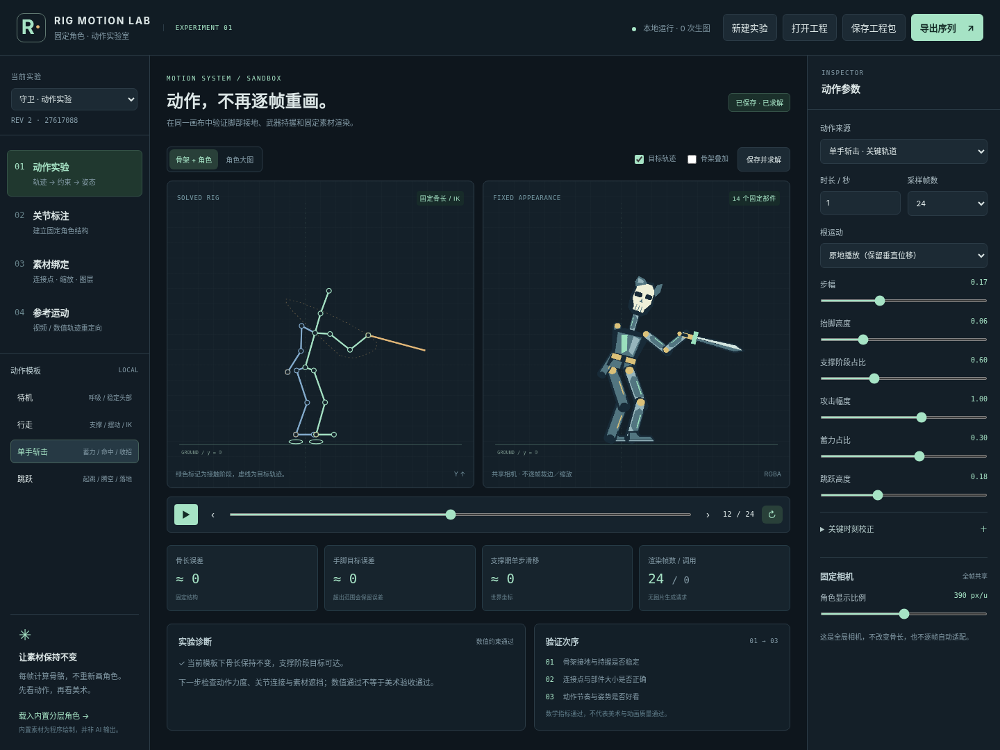

# Rig Motion Lab · 动作实验室

**v0.4.0 · 多帧联动、动作影响范围与部件编辑版**

新增骨长/角度/后代联动、IK/FK 画布调姿、可编辑关键帧、独立动作状态、层级排序与遮挡关键帧、会话撤销重做。骨骼与层级基础操作见 [0.2 编辑说明](docs/EDITOR.md)，模板主姿势和高亮选择见 [0.3 编辑说明](docs/EDITOR03.md)。更新后重启服务并强制刷新，顶部显示 `EDITOR 04`。

不需要原 Spine 骨骼，不需要图片生成 API。使用「关节标注 → 控制轨迹 → 固定骨长约束 → 固定 PNG 素材渲染」验证动作，而不是逐帧重画角色。与 Sprite Forge 的目录、端口、工程格式完全独立；不读取或修改其 data 目录。



## 新增：卡通 / Q 版简化骨架

关节页可显式切换「标准人体 / 卡通·Q版像素」，并逐条选择单段手臂或单段腿。
单段围绕连接点刚性旋转，不制造可编辑肘膝；旧项目和双段 IK 保留。
模板设置、动作、绑定和导出均保存到当前项目，详见 [卡通骨架使用与边界](docs/CARTOON_RIG.md)。

## 0.4 新增：编辑一次，联动多帧

转换模板后不必逐帧重复调整。新增 **当前帧 / 附近一段 / 指定区间 / 整个动作**，
默认前后各 20% 平滑影响。旋转或平移会把本次差量按时间权重应用到原姿势，
保留动作变化，不把所有帧复制成同一姿势。时间轴显示色带与受影响数量。
支持修改强度、循环跨首尾、一次撤销整批，以及不重复叠加的「重设上次修改的影响范围」。
动作数据正常保存导出；骨长、部件、相机和其它动作不改变。IK 不可达与脚部接触仍需检查。

更新后重启 Python 并强制刷新页面，使用详情见 [0.4 多帧联动说明](docs/EDITOR04.md)。
本轮 172 项自动测试、33 项新界面桥接检查、39 项旧编辑回归和 9 项本机 HTTP 检查通过。
界面验证不等于用户真实素材的动作质量验收；Node 只用于运行新增算术回归测试。

## 0.3 新增：真正编辑模板动作 + 部件高亮选择

当前参数模板可转换成**独立完整姿势关键帧**，在骨架或角色图上直接拖动修改，支持数值编辑、关键帧插入/复制/移时/删除、三种插值和首尾联动。不是仅在固定模板上叠加偏移。

部件列表与角色图双向选择；实际 Alpha 轮廓高亮、透明像素穿透选取、Alt 轮选重叠部件、隐藏部件透视定位。高亮不写入素材和导出。

更新后重启服务、强制刷新，页头显示 `EDITOR 04`。先调整模板参数，再点击「将当前模板转为可编辑关键帧」；详情见 [0.3 编辑说明](docs/EDITOR03.md)。旧工程可读，新版工程不要用旧程序覆盖。仍无图片 API 调用，不在页面输入地址或 Key。


## 先明确本版能测试什么

| 模块 | 已实现 | 边界 |
|---|---|---|
| 关节标注 | 18 个标准关节的比例建议、拖动/数值编辑、肘膝弯曲侧、确认骨架 | 比例模板，不是卡通人体识别；遮挡点需人工确认 |
| 参数化动作 | 待机、行走、单手斩击、跳跃；时长、采样帧数、步幅、抬脚、蓄力、幅度、根运动 | 人工设计的运动规则，不是学习得到的通用动作生成模型 |
| 控制关键帧 | IK 目标、FK 骨骼角度；编辑/拖动/复制/删除关键帧；平滑、线性、保持插值 | FK 优先于 IK，会重新报告接触误差；不提供 Bézier 手柄编辑 |
| 部件层级 | 拖动排序、显隐、绑定骨骼；按动作时间保存遮挡切换 | 层级为阶跃变化，不是三维深度或父子变换 |
| 约束求解 | 两骨 IK、固定骨长、固定弯曲侧、接触目标、不可达误差 | 不是全身动力学、碰撞检测或完整解剖关节角限制 |
| 素材绑定 | 固定分层 PNG、连接点 A / 轴向点 B、缩放、旋转、偏移、图层、显隐 | 刚性剪纸附件；未实现网格权重、隐藏部位自动补画 |
| 手工拆件 | 在参考图点多边形，取出已有像素并绑定骨骼 | 不能推断遮挡后的衣服、躯干或另一侧肢体 |
| 参考动作 | 导入统一 JSON、明确校准帧、局部角度重定向、接触锁定、平滑 | 仅二维；没有自动镜像、自动识别武器或三维透视缩短 |
| 参考视频 | 可选本地 MediaPipe VIDEO 提取器、观测缓存、短缺失插值、长遮挡拒绝 | **真实模型未在交付环境运行**；需额外依赖/模型，不能把合成示例当动捕 |
| 渲染/导出 | 同一相机、逐帧固定 PNG、透明图集、GIF、轨迹/诊断 JSON | 不输出 Spine JSON；不自动生成手工像素轮廓 |

**该实验首先验证结构与管线，不保证动作已经达到商业游戏质量。** 示例角色为代码绘制的分层素材；「合成轨迹」也来自程序，不是真人视频。数学误差接近零，并不代表角色关节美术、动作力度或遮挡表现正确。

## 1. 启动

核心需要 **Python 3.11+**；本次实际使用 Python 3.13.5。无需 Node 构建、GPU、模型密钥。首次安装 Python 依赖需要网络。

### Windows

解压后进入 `rig-motion-lab`，双击 `start.bat`。不要关闭终端。

### macOS / Linux

```bash
cd rig-motion-lab
bash start.sh
```

启动后打开：

```text
http://127.0.0.1:8020
```

首次启动自动创建内置守卫实验：14 个分层部件、18 个关節、24 帧行走动作。没有图片生成调用。

### 手动启动

```bash
python -m venv .venv
# Windows PowerShell: .venv\Scripts\Activate.ps1
# macOS / Linux: source .venv/bin/activate
python -m pip install -r requirements.txt
python -m uvicorn lab.main:app --host 127.0.0.1 --port 8020 --workers 1
```

保持单进程与回环地址。端口冲突可改成 8021，并打开同一端口。应用带本地 Host / Origin / 写入标头保护，**不要直接部署到公网**。

## 2. 十分钟验证顺序

### 先试内置动作，不急着接自己的图

在「动作实验」选择待机、行走、斩击、跳跃。左边是求解骨架，右边始终是同一组 PNG。调大步幅或攻击幅度，观察何时目标不可达；系统会保持骨长并显示误差，不会偷偷拉长手脚。参数滑块释放后会保存并求解。

可新建「短腿比例」实验，比较相同动作规则对不同比例的适配。大幅度不一定可达，这是诊断应该暴露的事实。

四项指标中，误差单位以标定高度为基础，`‰` 表示千分之一高度；没有单位的 `≈0` 表示低于显示精度。脚滑移指标在**世界坐标**里计算，原地播放时支撑脚向屏幕后方移动并不是该指标的失败。

### 再测试关键姿势

暂停并拖动时间轴，使用「关键帧编辑 · IK / FK」选择手腕/脚踝/骨盆位置、武器角度或骨骼角度轨道。可编辑已有点、移动时间、复制、删除，也可勾选画布调姿后直接拖动。武器握持点由绑定关系确定，不用每帧猜位置。

同一目标、同一时间的新校正会替换原校正；删除列表项可恢复。循环动作的首尾校正不一致可能破坏闭合，需要人工检查。

### 最后检查素材

「部件层级」选择武器，试着把显示缩放改成 0.8 或 1.2，再播放攻击。PNG 原图保持不变。连接点 A 应在握柄，B 指向刀尖/杖头；骨骼长度与显示长度独立于 PNG 分辨率。

相机缩放和部件缩放是两件事：前者影响整个角色及所有帧，后者只影响该附件。附件偏移非零会改变连接基准，属于用户明确修改。

## 3. 使用自己的角色

新建「自己的角色 · 空素材工程」，在「骨骼编辑」上传 PNG / JPEG / WebP。单图最大 8 MB、最长边 2048 像素。为防止新角色混入示例身体，上传新参考会清空当前部件绑定；磁盘原文件不覆盖，重要工程请先下载保存。

默认将角色前景按固定高度放入坐标空间。**关节点只是比例建议**，要拖动肩、肘、腕、髋、膝、踝和脚尖到正确位置。左右属于角色自身，不是画面左右。肘膝弯曲方向可单独选择 ±1。编辑后骨架重新标记为待确认；确认后才允许导出。

单张合并图不能自动产生完整动作素材：

1. 有独立部件时，进入「部件层级」上传对应 PNG，选骨骼，设置 A/B 锚点和局部尺寸。
2. 只有合并图时，展开「从参考图手动拆件」，选择绑定骨骼，点击「开始多边形选区」，在左侧图上点至少 3 个点后完成。每次只取出已有可见像素。
3. 手臂遮住躯干等部位，拆开后可能有空洞。需要自行补画并替换 PNG；本版不接生成模型补画，不假装能恢复隐藏内容。

建议先只绑定头、躯干和一条手臂/武器，验证持握和关节，再扩展整角色。没有部件时只显示骨架，导出会明确拒绝，不会输出空白角色。

## 4. 参考动作导入

### 不安装模型，也可以先测试重定向

「参考运动 → 载入合成轨迹」会载入明确标为**非视频**的斩击数据，验证后半条管线。也可以导入 `examples/reference-attack.json`。

外部 JSON 使用 `rig-motion-reference.v1`；结构见 `docs/REFERENCE_FORMAT.md`。提供完整关節、递增时间、固定的坐标标定和可选接触标记。不要逐帧用身体包围框重新归一化。

校准帧是**源运动和目标初始姿势的对应点**：该时刻的局部角度变化为零，并映射到目标 bind pose。不合适的校准姿勢会扭曲整段动作。当前工具不是原姿态全比例复制器。

「动作变化幅度」缩放角度变化，不改变目标骨长；平滑在角度轨道进行。接触锁定仅使用 JSON 中实际提供的接触标记，不对没有标记的数据声称完成锁脚。检测出的接触仍需人工核查。

### 可选：从视频提取人体动作

这一环节基于 MediaPipe Tasks 的本地 Pose Landmarker。请优先在依赖可用的 Python 3.11/3.12 环境安装（核心已在 3.13 测试，**不代表可选模型包也已验证兼容**）：

```bash
python -m pip install -r requirements-video.txt
```

从 Google 官方页面下载 `pose_landmarker_lite.task`，保存到项目的 `models/`。官方链接见 `docs/SOURCES.md`。应用不会自行联网下载模型。

复制 `.env.example` 为 `.env`，设置：

```dotenv
RIG_LAB_POSE_MODEL=models/pose_landmarker_lite.task
```

重启服务。「参考运动」会显示本地检测器是否就绪，然后可上传视频。支持 MP4/MOV/WebM/AVI；最多 50 MB、20 秒、240 个采样点。优先固定机位、单人完整入镜、视角相近的视频，不建议直接用含界面/剪辑的屏幕录制。

实现使用递增毫秒时间戳和 RGB 帧；按一次确定的身高、地面和原点转换到二维空间。可见性不足的短缺失可插值，端点缺失或连续超过 3 个采样帧的遮挡会拒绝，避免长距离乱补。接触标记依据速度/高度的简单阈值，不是学习得到的接触识别。

解析完成保存原始关节点与置信度、固定标定和转换后的轨迹。上传的视频临时文件会在任务结束删除；关节点与诊断保留在工程目录。若解析期间改动工程导致 revision 冲突，轨迹文件仍保留，但不会覆盖新工程。

**交付环境无法安装额外模型依赖：pip 访问包源发生 DNS 失败。因此没有运行真实 MediaPipe 推理，也没有验证你的真实视频质量。** 检测调用协议、坐标转换、遮挡处理和重定向已通过桩/合成测试；不能把这当作真人动捕成功。

## 5. 导出与 Sprite Forge

点击「导出序列」，选择 64 / 128 / 256 / 512。全部输出帧共用固定相机，不会逐帧居中、裁边或自适应放大。

系统按素材 Alpha 包围框角点检查潜在裁切。因为是保守检查，少数旋转部件可能出现较保守的提示。先调整全局相机或部件大小；明确勾选「允许裁切」才继续有风险的导出。

```text
frames/000.png ...      固定画布的透明 PNG
spritesheet.png        等格图集
preview.gif            共享调色板、透明索引的预览
atlas.json              每帧位置、时长、轴心
motion.json            求解骨架、目标、接触、根运动、事件、诊断
```

GIF 是索引色预览，不代替完整 Alpha PNG。非循环动作最后保留 120ms 停留；循环动作不重复采样终点。轨迹 JSON 的播放时长与 PNG 各帧时长一并导出。

将 `frames/` 里的编号 PNG 导入 Sprite Forge 的序列导入即可继续后处理。**motion.json 是本项目格式，不是 Spine 文件，也不是 Sprite Forge 已支持的元数据包**；特殊帧时长和事件需要在目标工具中核对/设置。本版尚未加自动接口桥接或共享色板像素修整。

## 6. 保存、隐私与 Git

顶部「保存工程包」下载 `.riglab.zip`，含标注、部件 PNG、动作参数与参考轨迹；「打开工程」始终作为新 ID 的副本载入，不覆盖原件。服务也把工程实时保存在 `data/`。素材文件不主动删除，长期实验请自行管理磁盘空间。

本地 `.env` 仅用于数据目录、可选模型路径；本项目**不读取图片 API Key、不提供页面 Key 输入、不访问 Sub2API**。运行期间没有生图费用。模型和依赖安装由用户显式执行。

工程使用乐观 revision 锁；过期写入被拒绝。不要多进程启动或公开暴露服务。`.env`、`data/`、模型权重和缓存已在 `.gitignore` 排除。

这是独立仓库 `ONLLL/Rig-Motion-Lab`，没有修改 `ONLLL/sprite-forge`。交付包含完整源码；更新现有克隆可运行 `git pull --ff-only origin main`，然后重启 Python 并强制刷新网页。不要提交本地 data 和真实 `.env`。

## 7. 测试与验收

```bash
python -m pip install -r requirements-dev.txt
python -m pytest -q
node --check lab/static/app.js
node --check lab/static/editor.js
```

v0.2 验证见 `docs/EDITOR.md`、`docs/editor-tests.txt`、`docs/editor-browser-results.json`（85 项测试、24 项 Chromium 桥接交互检查、9 项真实本机 HTTP 检查）。`docs/VALIDATION.md`、`docs/tests.txt`、`docs/browser-results.json` 为 v0.1 的历史记录。测试区分数学、API/文件安全和界面，不把它们等同于动画质量。核心没有网格权重、自动拆分、自动遮挡补画、三维转向、双手武器约束、物理碰撞或完整骨骼编辑器。

下一轮最有价值的验收是用你的角色部件跑一个方向的行走和攻击，检查三件事：骨架有没有滑步，素材连接是否正确，动作节奏是否被你接受。
